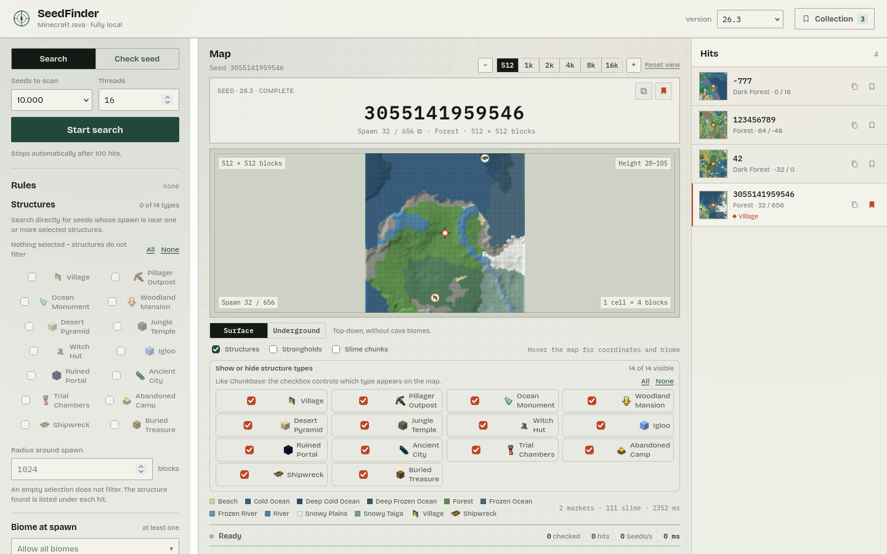
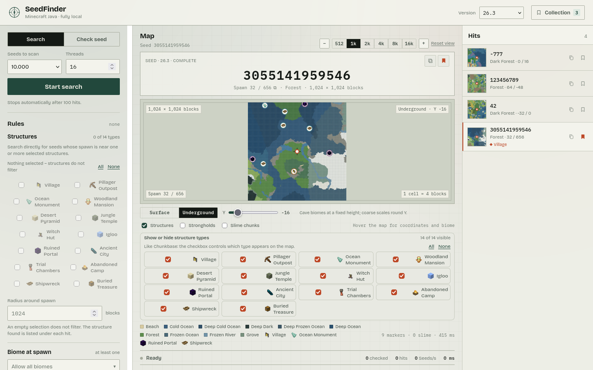
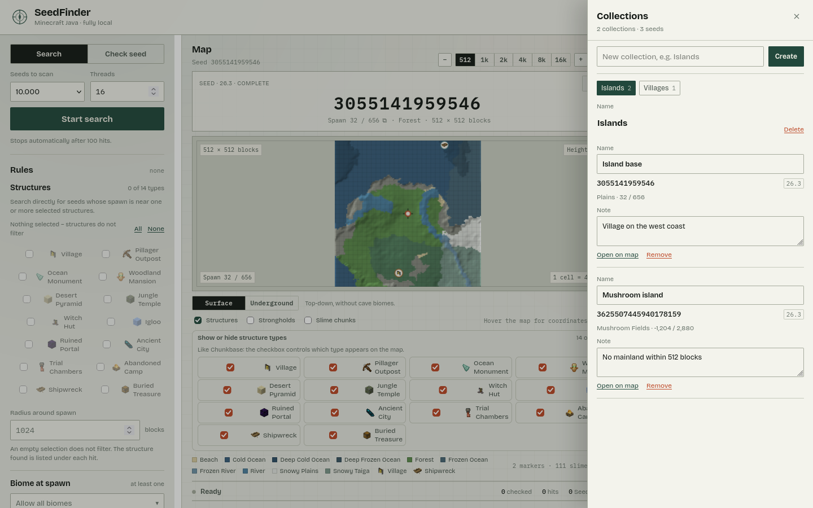

# SeedFinder

Local desktop app for finding Minecraft Java seeds – a Chunkbase-style map plus
your own multithreaded search over random 64-bit seeds. Everything runs on your
machine: no cloud, no Minecraft installation, no network access at runtime.



## Features

- **Versions:** Minecraft 1.6.4 through 26.3, including every patch line
  (1.21.5–1.21.11, 26.1, 26.1.1, 26.1.2, 26.2).
- **Search:** 1,000 to 1,000,000 seeds, multithreaded, live progress and
  seeds/s, manual stop, automatic stop after 100 hits.
- **Rules, all in the UI:** spawn biome (any of several), biome share inside a
  radius, biome at a fixed coordinate, island spawn, approximate spawn surface
  (grass/sand/snow/stone/water), end portal eye count, and 14 structure types
  with a search radius.
- **End portal eyes:** search for portals with a minimum number of eyes
  (4+ ≈ 1 in 47 seeds, 5+ ≈ 1 in 231, 6+ ≈ 1 in 1,848), optionally requiring
  the portal to be active. Verified 12-eye seeds are bundled as one-click
  presets for the single-seed checker.
- **Map:** 1:4 hillshade plus 1:16 and 1:64 overviews, 512 to 16,384 blocks,
  drag to pan, wheel/buttons to zoom. **Surface** samples Y 300 (Y 255 before
  1.18) so the world is shown from above without caves. **Underground** samples
  any Y height for cave biomes such as lush caves, dripstone caves and deep
  dark.
- **Map layers:** structures with per-type checkboxes (All/None), strongholds
  and slime chunks; item sprites, legend, spawn crosshair, hover coordinates.
- **Copy anything:** the seed, its spawn coordinates, and the coordinates under
  the pointer are one click away.
- **Hits and collections:** thumbnails, matched rules, found structures,
  bookmarks, named collections with a name and note per seed.
- **English UI**, all fonts bundled locally.

## Screenshots

### Underground layer

Cave biomes at a fixed height, with the structure layer still on top.



### Collections

Saved seeds with names, notes and a one-click jump back to the map.



## Install

### Linux (x86_64)

**AppImage (recommended):** download `SeedFinder_0.2.0_amd64.AppImage`, make it
executable and run it. It needs FUSE 2 (`libfuse2` on Debian/Ubuntu); no
installation is required.

```bash
chmod +x SeedFinder_0.2.0_amd64.AppImage
./SeedFinder_0.2.0_amd64.AppImage
```

**Tarball:** extract the archive and run the user-level installer:

```bash
tar -xzf seedfinder-0.2.0-linux-x86_64.tar.gz
cd seedfinder-0.2.0-linux-x86_64
./install.sh
```

This installs without root:

| What | Path |
|---|---|
| Program | `~/.local/bin/seedfinder` |
| Icon | `~/.local/share/icons/hicolor/512x512/apps/seedfinder.png` |
| Menu entry | `~/.local/share/applications/seedfinder.desktop` |

Requirements: x86_64 Linux with glibc plus WebKitGTK 4.1, GTK 3 and libsoup 3 –
Debian/Ubuntu `libwebkit2gtk-4.1-0 libgtk-3-0 libsoup-3.0-0`, Fedora
`webkit2gtk4.1 gtk3 libsoup3`, Arch `webkit2gtk-4.1 gtk3 libsoup3`.

### Windows (x86_64)

Run `SeedFinder_0.2.0_x64-setup.exe` and follow the installer. Windows 10/11
with the WebView2 runtime (included in current Windows builds).

The Windows installer is produced by the included GitHub Actions workflow
(`.github/workflows/release.yml`) or on a Windows machine with
`scripts/build-windows.ps1`; it is not built on Linux hosts.

## Verify a download

```bash
sha256sum -c SHA256SUMS.txt                  # Linux tarball
sha256sum -c SHA256SUMS-appimage.txt         # AppImage
# Windows PowerShell:
Get-FileHash .\SeedFinder_0.2.0_x64-setup.exe -Algorithm SHA256
```

## Build from source

Requirements: Rust 1.77+, Node.js 20+, a C compiler, and the Tauri 2 system
libraries (Linux: `webkit2gtk-4.1`, `gtk+-3.0`, `libsoup-3.0`).

```bash
npm install
npm run build
cd src-tauri && cargo build --release && cd ..
bash scripts/build-release.sh        # release tarball + checksums
```

On Windows, the same steps run through PowerShell and produce an NSIS
installer:

```powershell
powershell -ExecutionPolicy Bypass -File scripts/build-windows.ps1
```

## Engine

The world generation comes from the vendored
[`xpple/cubiomes`](https://github.com/xpple/cubiomes) fork (MIT, upstream
`Cubitect/cubiomes`), which models biome generation up to 26.3. A small C shim
(`src-tauri/src/ffi/shim.c`) keeps every cubiomes struct on the C side, so Rust
only sees opaque pointers.

Tests and checks:

```bash
npm run build
cd src-tauri
cargo test
cargo clippy --all-targets
cargo fmt --check
```

## End portal seeds

A portal with all 12 eyes appears roughly **once per trillion seeds**, so
brute-forcing it is not realistic. The rule builder therefore offers two
paths:

- Lower the minimum eye count to 4–6 to find usable partial portals by
  scanning. This rule runs last because generating stronghold pieces is
  expensive (around 200 seeds/s per thread for one stronghold).
- Select “Check seed” and use one of the verified 12-eye seeds offered next to
  the rule; then press “Check against rules” to verify it in the current
  version. Verified seeds exist for 1.16.5, 1.21.1 and 1.21.4.

## Known limits

- Spawn surface is approximate: cubiomes exposes biomes and heights, not block
  ids, so the category is derived from the spawn biome. It cannot identify an
  exact block such as podzol or coarse dirt.
- The spawn is cubiomes' approximation; heights from `mapApproxHeight()` are
  approximate as well.
- The underground layer samples one fixed Y height. At 1:16 and 1:64 cubiomes
  rounds that height to 16 or 64 blocks. Cave biomes exist from 1.18 on; older
  versions show the surface on that layer.
- Structures follow cubiomes, not a running game. Dense kinds (shipwreck,
  treasure) are thinned out on very large map extents to keep the preview fast.
- At most 100 hits per run.
- Not included: Nether/End maps, 3D relief, PNG export, further UI languages.
- Only Linux has been built and tested on this host; the Windows build is
  produced on Windows/CI and is not verified here.

## License

SeedFinder is MIT-licensed; see [LICENSE](LICENSE). Third-party notices and
full license texts are in [release/LICENSES.md](release/LICENSES.md). Map
marker sprites come from the Minecraft Wiki and are Mojang property; they are
bundled locally only. SeedFinder is not affiliated with Mojang or Microsoft.
